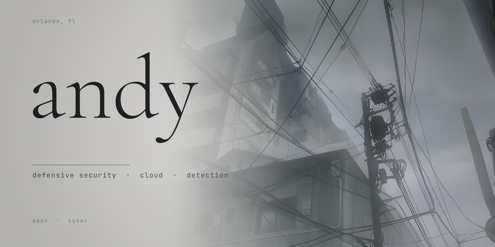

### about

defensive & cloud security. network engineer intern at disney, previously infosec intern at the ascend collective. it student at valencia → ucf. security+ · cysa+. building cloud triage labs, honeytoken tooling, and hardened-by-design apps.

[infainted.dev](https://infainted.dev) • [linkedin](https://www.linkedin.com/in/pierregreg)

---

### core skills

- **languages:** python · c# · c++ · bash · sql
- **security ops:** threat hunting · incident response · alert triage · log analysis · detection tuning · runbook validation · honeytokens
- **cloud security:** aws iam · cloudtrail · s3 · security groups · cspm · overpermissive policy detection
- **network:** firewall rule review (palo alto · cisco asa) · syslog · wireshark · nmap · pcap analysis
- **grc:** nist csf · nist sp 800-53 · ferpa · risk assessment · compliance reporting
- **tools:** solarwinds · datadog · servicenow · prowler · cartography · burp suite
- **automation:** ansible · docker · git · postgresql · neo4j
- **os:** windows server 2022 · linux (ubuntu, kali) · macos

---

